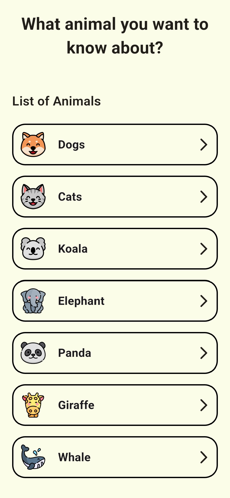
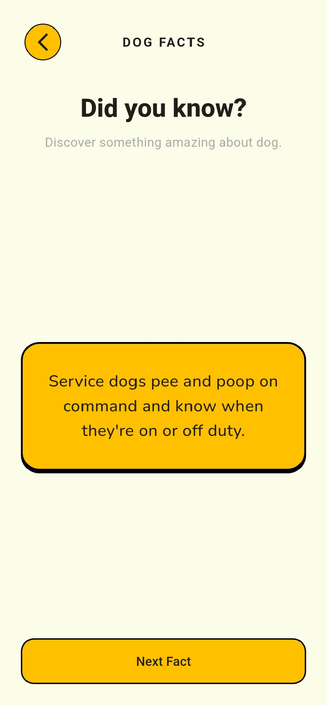
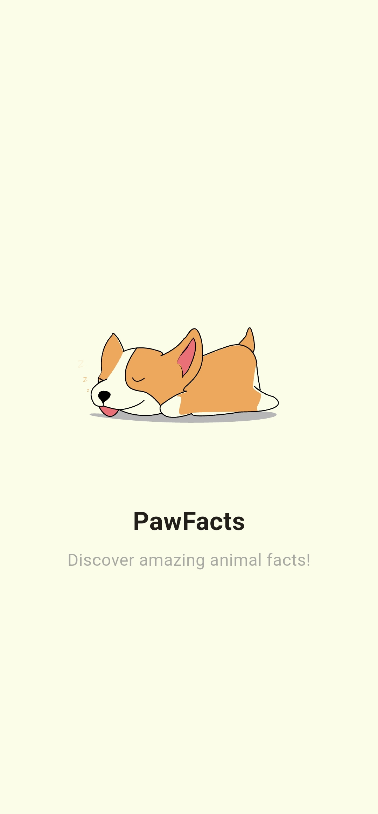

# 🐾 PawFacts

**Discover amazing animal facts!**

PawFacts is a Flutter mobile application that allows users to explore interesting and random facts about different animals. Simply choose an animal and discover something new!

## 📱 Features

- Explore facts about different animals.
- Fetch random animal facts using a public API.
- Discover facts about dogs, cats, whales, koalas, and other animals.
- Refresh and discover another random fact.
- Simple and user-friendly interface.
- Animated splash screen using Lottie.

## 🛠️ Built With

- **Flutter** – Cross-platform mobile application development.
- **Dart** – Programming language.
- **Riverpod 3** – State management and dependency injection.
- **Dio** – HTTP client for API requests.
- **GoRouter** – Application navigation and routing.
- **Lottie** – Animations.

## 🌐 API

PawFacts uses [Some Random API](https://some-random-api.com/) to retrieve random animal facts.

**API Base URL:**

```text
https://api.some-random-api.com
```

**Example Endpoint:**

```text
https://api.some-random-api.com/facts/dog
```

Other supported animal endpoints include cats, foxes, pandas, koalas, kangaroos, giraffes, whales, elephants, and more.

## 🏗️ Project Architecture

The project follows Clean Architecture principles, separating business logic, data handling, and presentation.

```text
lib/
├── core/
│   ├── network/
│   └── theme/
│
├── features/
│   ├── animal_facts/
│   │   ├── domain/
│   │   ├── data/
│   │   └── presentation/
│   │
│   ├── dogs/
│   ├── cats/
│   ├── koala/
│   └── ...
│
└── shared/
    ├── widget/
    └── ...
```

### Architecture Overview

- **Domain:** Contains entities, repository contracts, and use cases.
- **Data:** Handles API requests, data models, and repository implementations.
- **Presentation:** Handles UI, Riverpod providers, and notifiers.
- **Core:** Contains shared application configurations, theme, and network setup.
- **Shared:** Contains reusable UI components.

## 🚀 Getting Started

### Prerequisites

- Flutter SDK
- Dart SDK
- Android Studio or VS Code
- Git

### Installation

1. Clone the repository:

```bash
git clone https://github.com/YOUR_USERNAME/pawfacts.git
```

2. Navigate to the project directory:

```bash
cd pawfacts
```

3. Install dependencies:

```bash
flutter pub get
```

4. Run the application:

```bash
flutter run
```

## 📸 Screenshots

### Home Page



### Dog Facts



### Splash Screen



## 🎨 Design Inspiration

The color theme and overall visual direction of PawFacts were inspired by the **Pet Health Tracker Mobile App** design on Dribbble.

Design reference: [Pet Health Tracker Mobile App – Dribbble](https://dribbble.com/shots/27498070-Pet-Health-Tracker-Mobile-App)

Credit to the original designer for the design inspiration.

## 👨‍💻 Author

Developed by **KEOBI**.
